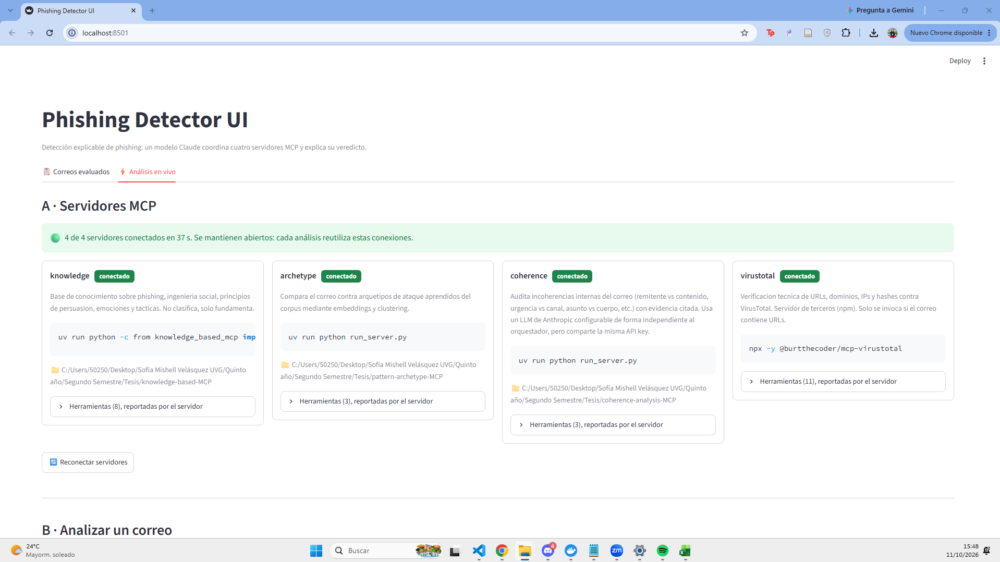
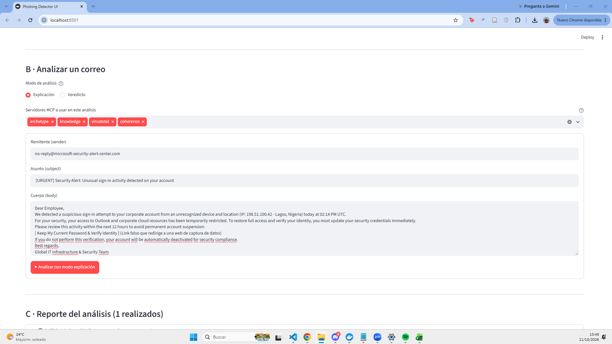
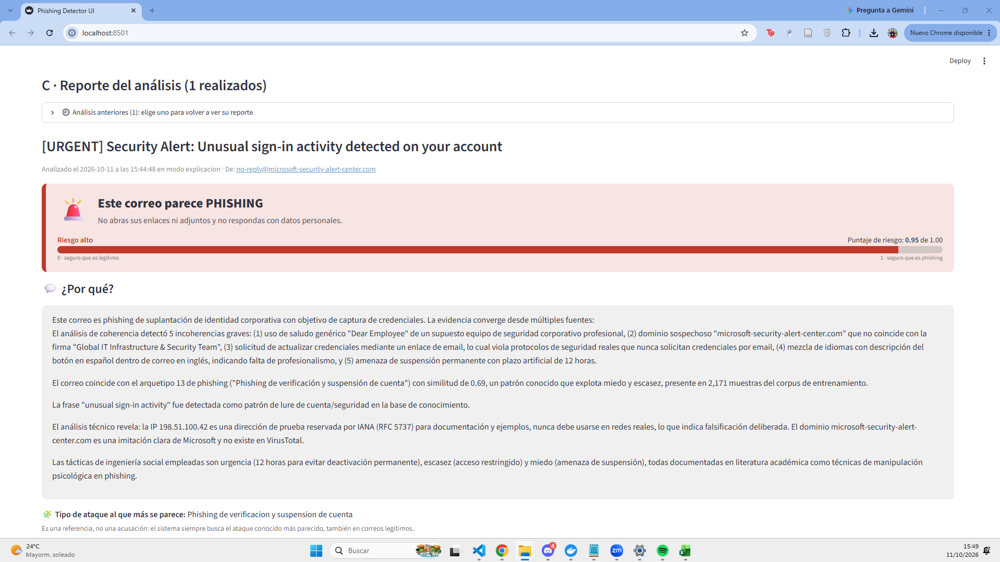
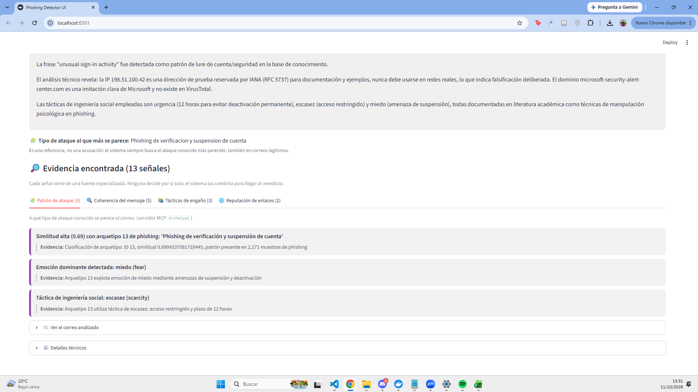
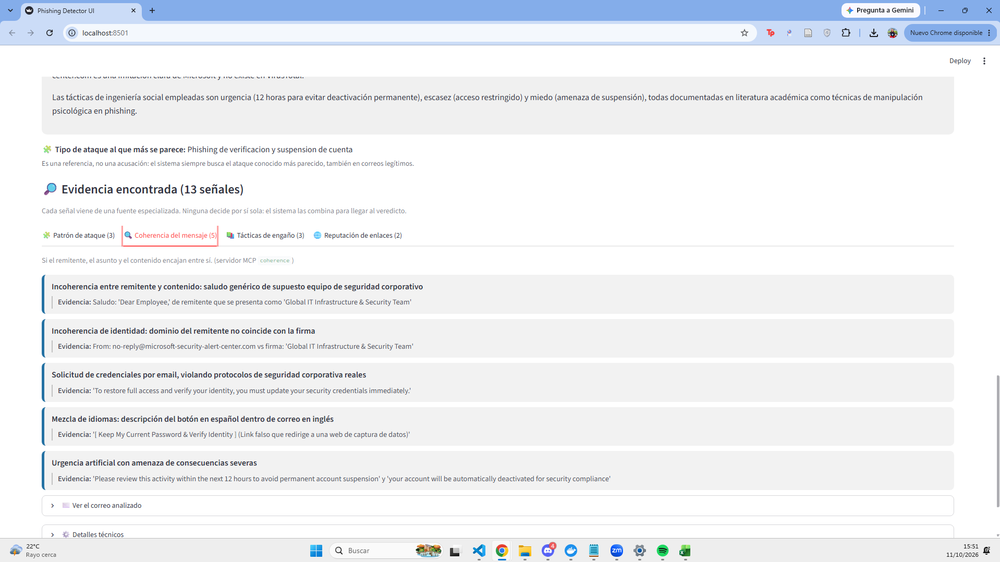
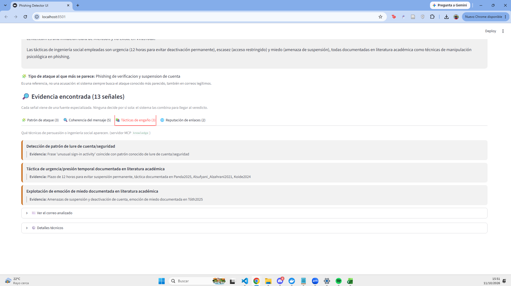
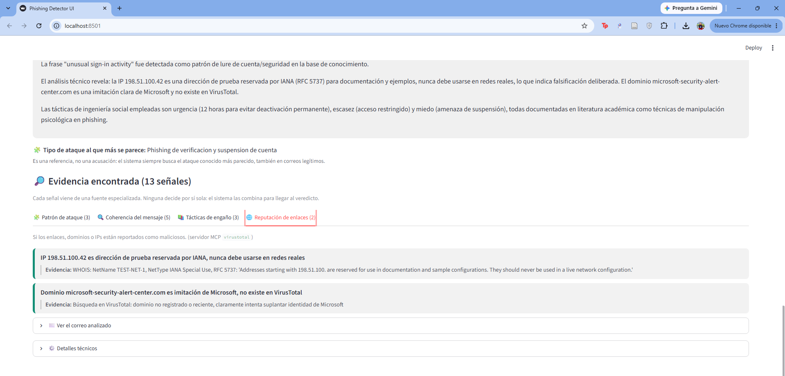
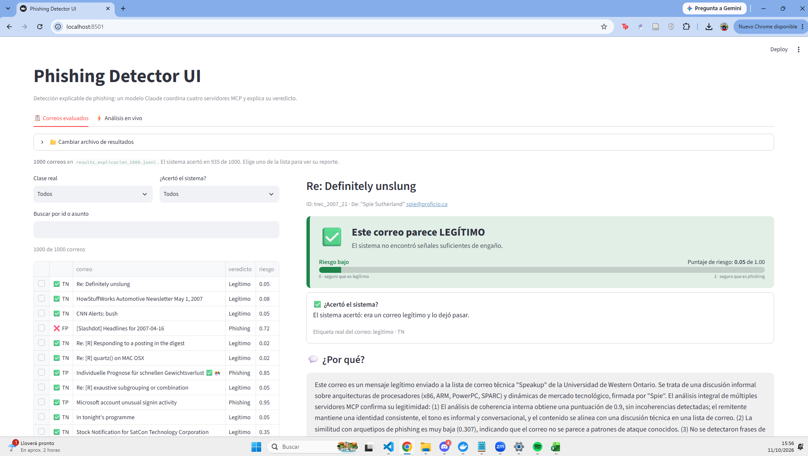
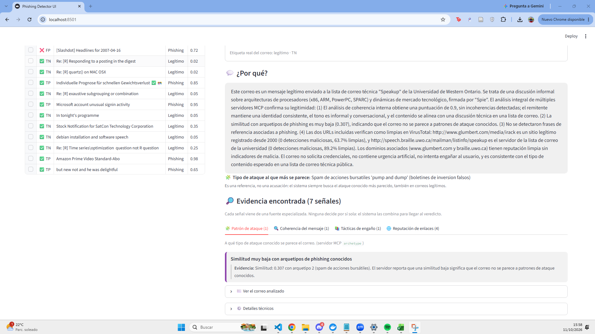
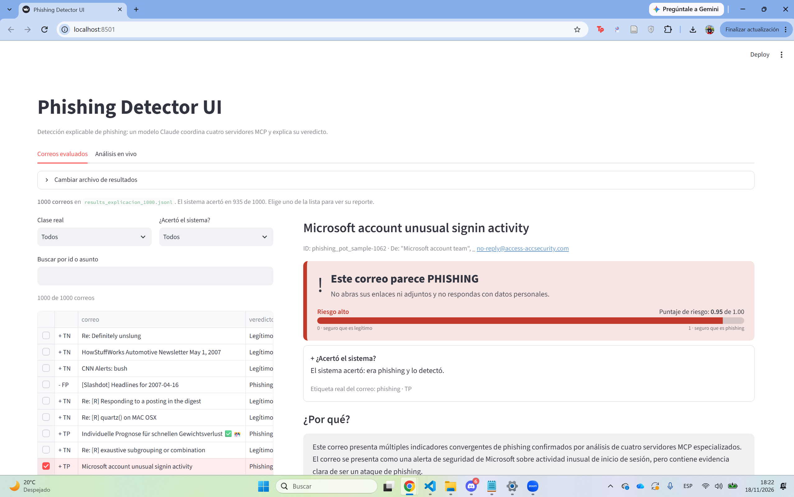

# Prototipo de sistema para la detección de phishing en correos electrónicos usando modelos de lenguaje grandes y servidores MCP

Trabajo de Graduación — Universidad del Valle de Guatemala, Facultad de Ingeniería.
Ingeniería en Ciencia de la Computación y Tecnologías de la Información, 2026.

## Descripción

El *phishing* sigue siendo una de las principales amenazas del correo electrónico porque usa técnicas de **ingeniería social** para convencer a los destinatarios de hacer clic en enlaces, entregar credenciales o realizar pagos. Los filtros tradicionales, basados en reglas, reputación y firmas, detectan bien los indicadores técnicos, pero les cuesta reconocer la manipulación que está en el *contenido* y el *contexto* del mensaje.

Este proyecto desarrolla y evalúa un prototipo que **clasifica correos como `phishing` o `legitimo` y explica por qué**. Un modelo de lenguaje grande (Claude, vía la API de Anthropic) actúa como **orquestador**: decide qué herramientas consultar según cada correo y sintetiza el veredicto final. Las herramientas las proveen cuatro servidores **Model Context Protocol (MCP)**:

| Servidor | Tipo | Qué aporta |
| --- | --- | --- |
| `knowledge-based-MCP` | Propio | Base de conocimiento sobre phishing: principios de persuasión, emociones explotadas y tácticas de ingeniería social. |
| `pattern-archetype-MCP` | Propio | Compara el correo con **16 arquetipos semánticos** de ataque aprendidos del corpus mediante *embeddings* y K-Means. |
| `coherence-analysis-MCP` | Propio | Detecta incoherencias internas (remitente vs. contenido, urgencia vs. canal, asunto vs. cuerpo) y cita la evidencia. |
| VirusTotal (`@burtthecoder/mcp-virustotal`) | Terceros | Verifica la reputación de URL, dominios e IP. Solo se invoca si el correo contiene indicadores de red. |

Ningún servidor clasifica por sí solo: aportan evidencia y el orquestador construye el veredicto. El sistema tiene dos modos:

- **Modo veredicto**: clasificación y puntaje de riesgo (0 a 1), con menor costo, pensado para evaluar lotes grandes.
- **Modo explicación**: además del veredicto, entrega las señales detectadas por cada servidor, con evidencia citada, y una explicación en lenguaje claro.

```text
                      ┌──────────────────────────────┐
     correo  ───────► │   Orquestador (Claude + MCP) │ ───────►  veredicto + riesgo
                      └──────────────┬───────────────┘           + señales + explicación
                         tool use vía MCP (stdio)
        ┌──────────────────┬─────────┴────────┬─────────────────────┐
        ▼                  ▼                  ▼                     ▼
 knowledge-based    pattern-archetype   coherence-analysis      VirusTotal
 (conocimiento)     (arquetipos)        (coherencia, LLM)       (reputación URL)
```

### Resultados principales

Evaluación sobre **1,000 correos externos** que el sistema nunca vio (500 phishing y 500 legítimos), comparada con **Rspamd**, un filtro de spam de uso real:

| Métrica | Modo explicación | Modo veredicto | Rspamd |
| --- | --- | --- | --- |
| Exactitud | **93.5 %** | 91.5 % | 78.5 % |
| Precisión | 95.41 % | **96.01 %** | 73.87 % |
| Exhaustividad | **91.4 %** | 86.6 % | 88.2 % |
| F1-score | **0.9336** | 0.9106 | 0.8040 |
| Falsos positivos | 22 | **18** | 156 |
| Falsos negativos | **43** | 67 | 59 |

- La proporción de phishing subió del **9 %** al **94 %** entre el decil de menor y el de mayor similitud con los arquetipos semánticos.
- En la evaluación automatizada de las explicaciones, el **99.4 %** justificó el veredicto y el **99.5 %** citó señales concretas. Además, el **91.8 %** de las explicaciones de correos de phishing identificó señales de ingeniería social.

El detalle completo está en el [informe final](docs/informe_final.pdf).

## Tecnologías Utilizadas

- **Python 3.10+**: lenguaje de todos los componentes.
- **[uv](https://docs.astral.sh/uv/)**: gestión de entornos y dependencias (`pyproject.toml` + `uv.lock` por proyecto).
- **Model Context Protocol (MCP)**: SDK `mcp[cli]` para los servidores y el cliente.
- **API de Anthropic (Claude)**: orquestador (`claude-haiku-4-5`) y motor del análisis de coherencia.
- **Pydantic**: validación de los esquemas de entrada y salida.
- **sentence-transformers** (`all-MiniLM-L6-v2`) y **scikit-learn** (K-Means): embeddings y construcción de arquetipos.
- **pandas**, **NumPy**, **matplotlib**, **seaborn** y **Jupyter**: preparación del corpus, análisis y figuras.
- **Streamlit**: interfaz web local con reportes explicativos.
- **Node.js / npx**: ejecución del servidor MCP de VirusTotal.
- **Rspamd**: línea base de comparación (filtro tradicional).
- **pytest**: pruebas unitarias y de integración.

## Requisitos Previos

- [Python](https://www.python.org/downloads/) 3.10 o superior.
- [uv](https://docs.astral.sh/uv/getting-started/installation/) (probado con 0.12.5).
- [Node.js](https://nodejs.org/) 18+ con `npm`/`npx` (probado con v22.19.0), necesario para el servidor de VirusTotal.
- [Git](https://git-scm.com/).
- Una **API key de Anthropic** (obligatoria para el análisis real).
- Una **API key de VirusTotal** (opcional; sin ella, el sistema funciona con los otros tres servidores).
- Conexión a internet la primera vez: se descarga el modelo de embeddings y el paquete npm de VirusTotal.

> **Nota sobre `package.json`:** el proyecto está escrito en Python, así que sus dependencias se declaran en el `pyproject.toml` de cada componente. El único componente de Node.js es el servidor de VirusTotal, que `npx` descarga y ejecuta automáticamente. Por eso no hay `package.json`.

## Estructura del repositorio

```text
2026-22049-velasquez-merida-sofia-mishell/
├── capturas/                          Capturas de pantalla del sistema (captura-01 … captura-10)
├── demo/
│   └── demo.mp4                       Video demostrativo
├── docs/
│   ├── informe_final.pdf              Informe final del Trabajo de Graduación
│   └── consentimiento_firmado.pdf     Consentimiento de uso de foto y video firmado
├── src/
│   ├── .env.example                   Variables de entorno necesarias (sin credenciales)
│   ├── phishing-detection-orchestrator/   Cliente orquestador (CLI, modo lote, interfaz Streamlit)
│   ├── knowledge-based-MCP/           Servidor MCP: base de conocimiento de ingeniería social
│   ├── pattern-archetype-MCP/         Servidor MCP: arquetipos semánticos (embeddings + K-Means)
│   ├── coherence-analysis-MCP/        Servidor MCP: análisis de coherencia interna
│   └── Trabajo-de-Graduacion/         Preparación del corpus, evaluación externa, Rspamd y análisis
└── README.md
```

Cada carpeta de `src/` tiene su propio `README.md` con documentación detallada. Además, el orquestador incluye [docs/FUNCIONAMIENTO.md](src/phishing-detection-orchestrator/docs/FUNCIONAMIENTO.md), y el repositorio de análisis incluye [DOCUMENTACION_PROYECTO.md](src/Trabajo-de-Graduacion/DOCUMENTACION_PROYECTO.md).

## Instalación

1. Clonar el repositorio:

   ```bash
   git clone https://github.com/Sofiamishel2003/2026-22049-velasquez-merida-sofia-mishell.git
   cd 2026-22049-velasquez-merida-sofia-mishell/src
   ```

2. Instalar las dependencias de los tres servidores MCP propios. Cada uno tiene su propio entorno virtual:

   ```bash
   cd knowledge-based-MCP    && uv sync && cd ..
   cd pattern-archetype-MCP  && uv sync && cd ..
   cd coherence-analysis-MCP && uv sync && cd ..
   ```

   Los arquetipos ya vienen precalculados en `pattern-archetype-MCP/artifacts/`, así que no hace falta regenerarlos.

3. Instalar las dependencias del orquestador, con los extras de interfaz, análisis y pruebas:

   ```bash
   cd phishing-detection-orchestrator
   uv sync --extra ui --extra analysis --extra dev
   ```

4. Configurar las variables de entorno. El orquestador lee su `.env` desde su propia carpeta:

   ```bash
   cp ../.env.example .env
   # Editar .env y colocar ANTHROPIC_API_KEY (y opcionalmente VIRUSTOTAL_API_KEY)
   ```

   Las rutas `KNOWLEDGE_MCP_PATH`, `PATTERN_ARCHETYPE_MCP_PATH` y `COHERENCE_MCP_PATH` ya apuntan a las carpetas hermanas (`../knowledge-based-MCP`, etc.). Solo hay que cambiarlas si los servidores se ubican en otro lugar.

5. *(Opcional)* Para reproducir los notebooks y la evaluación automatizada de explicaciones:

   ```bash
   cd ../Trabajo-de-Graduacion
   cp .env.example .env      # colocar ANTHROPIC_API_KEY
   ```

   Los notebooks usan el entorno del orquestador, que ya incluye el extra `analysis`. Los datos crudos no se versionan: `01_preparacion_corpus.ipynb` los descarga de Kaggle y `experiments/external_eval/build_eval_external.py` reconstruye el conjunto externo (ver [experiments/README.md](src/Trabajo-de-Graduacion/experiments/README.md)).

## Ejecución

Todos los comandos se ejecutan desde `src/phishing-detection-orchestrator/`. No hace falta arrancar los servidores MCP a mano: el orquestador los lanza como subprocesos y los cierra al terminar.

**Interfaz web** (se abre en `http://localhost:8501`):

```bash
uv run streamlit run experiments/eval_system/orchestrator_ui.py
```

La interfaz tiene dos pestañas:

- **Correos evaluados**: explora los 1,000 correos de la evaluación final. No consume API.
- **Análisis en vivo**: escribe un correo y obtén el veredicto, la explicación y la evidencia de cada servidor.

**Línea de comandos:**

| Para | Comando |
| --- | --- |
| Analizar un correo con explicación | `uv run phishing-orchestrator analizar --mode explicacion --archivo correo.txt` |
| Analizar un correo, solo veredicto | `uv run phishing-orchestrator analizar --mode veredicto --texto "texto del correo"` |
| Elegir qué servidores MCP usar (ablación) | agregar `--mcp archetype,knowledge` (o `--mcp none`) |
| Procesar un CSV completo (reanudable) | `uv run phishing-orchestrator lote --input datos.csv --output resultados.csv` |
| Probar la evaluación sin gastar tokens | `uv run python experiments/eval_system/run_evaluation.py --dry-run` |
| Ejecutar las pruebas | `uv run pytest` |

Cada servidor también tiene sus propias pruebas (`uv run pytest` dentro de su carpeta). Para probar `coherence-analysis-MCP` sin API key, usa `COHERENCE_LLM_PROVIDER="mock"`.

> **Consideraciones:**
> - Todo análisis real consume tokens de la API de Anthropic.
> - La primera conexión a `pattern-archetype-MCP` descarga el modelo de embeddings y puede tardar varios minutos.
> - La capa gratuita de VirusTotal permite 4 consultas por minuto y 500 por día; el orquestador respeta ese límite.

## Capturas

Las capturas de pantalla del sistema en funcionamiento están en la carpeta [`/capturas`](capturas/):

| | |
| --- | --- |
|  |  |
|  |  |
|  |  |
|  |  |
|  |  |

## Demo

El video demostrativo del proyecto se encuentra en [`/demo/demo.mp4`](demo/demo.mp4).

## Documentación

- El informe final del proyecto está disponible en [`/docs/informe_final.pdf`](docs/informe_final.pdf).
- El consentimiento de uso de foto y video firmado se encuentra en [`/docs/consentimiento_firmado.pdf`](docs/consentimiento_firmado.pdf).

## Autores

- **Sofía Mishell Velásquez Mérida** — Carné 22049

Asesor: Ing. Mba. Juan Carlos Canteo

## Licencia

Proyecto desarrollado con fines académicos como Trabajo de Graduación de la Universidad del Valle de Guatemala. Todos los derechos reservados por la autora.
