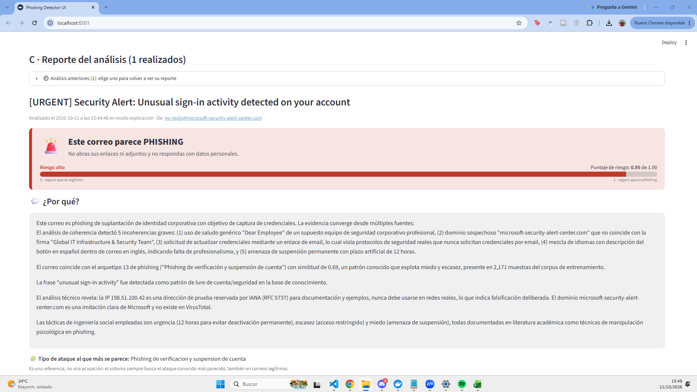
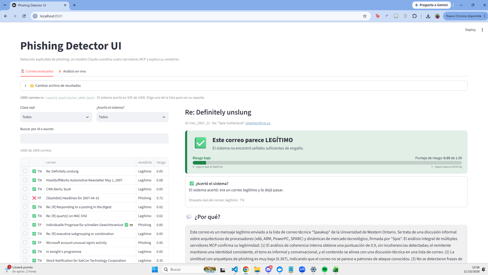
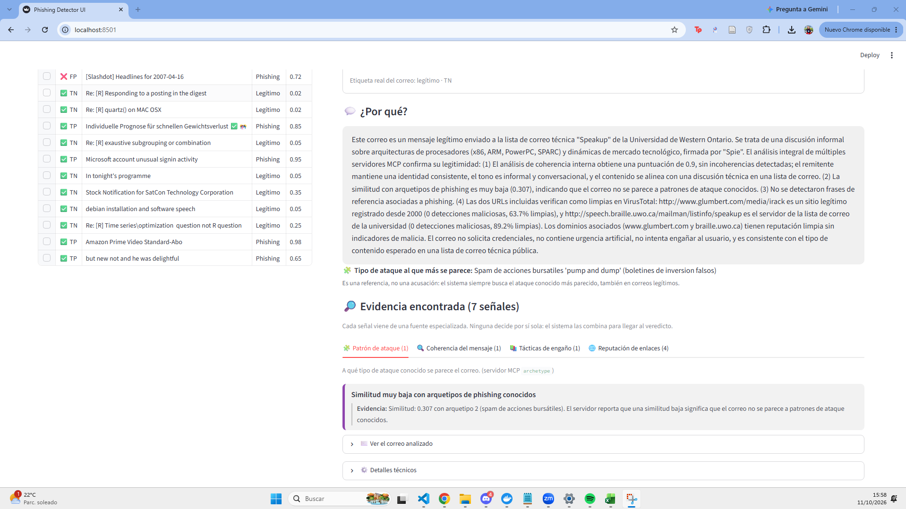
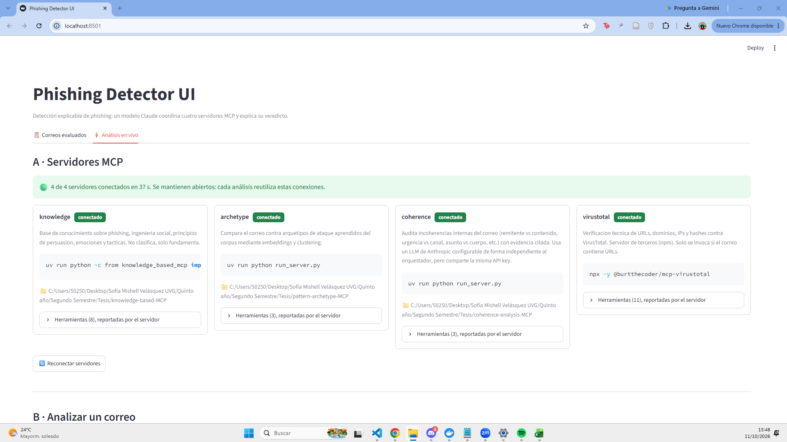
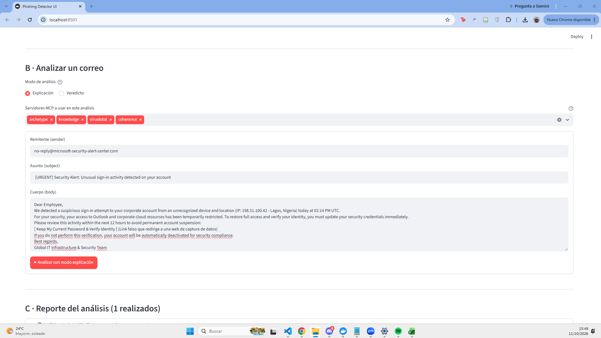
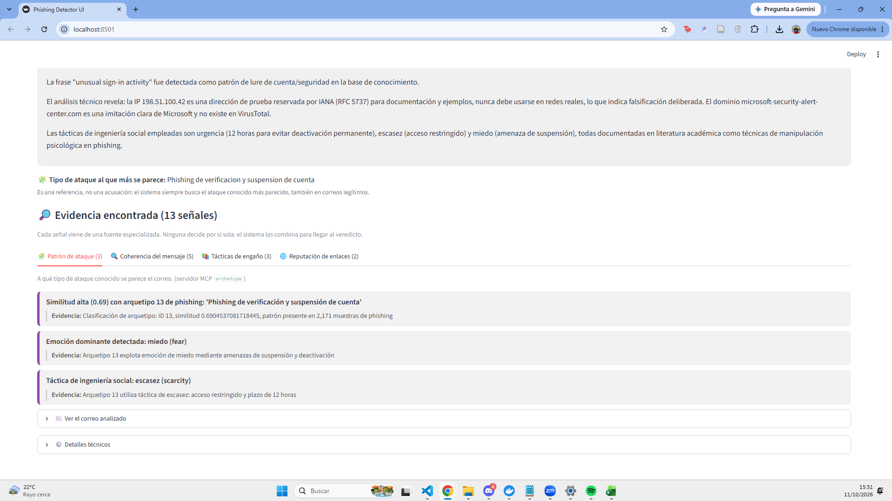
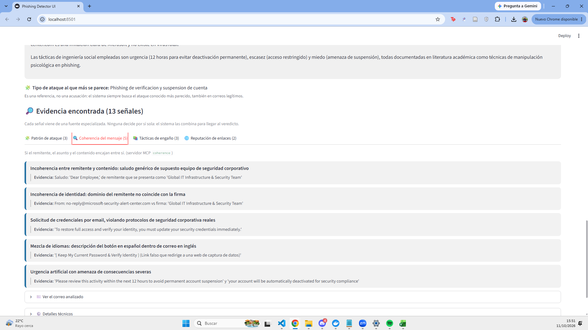
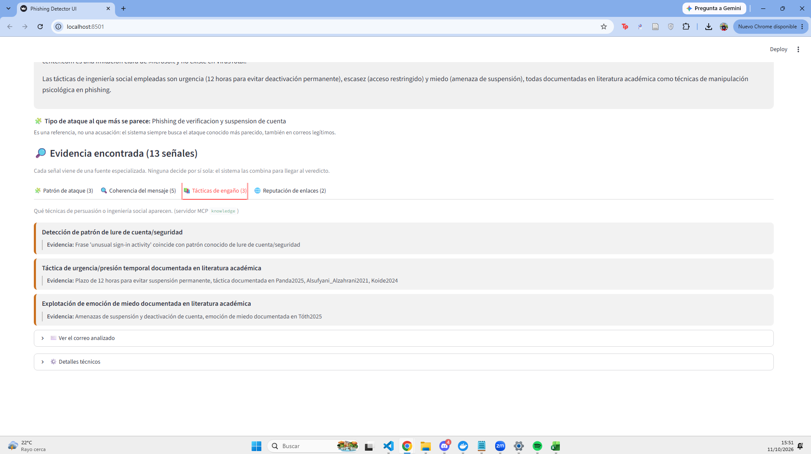
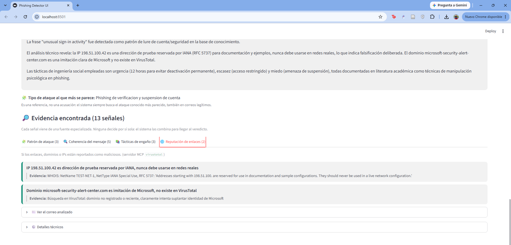

# Cliente orquestador de deteccion de phishing (MCP)

Trabajo de graduacion, Universidad del Valle de Guatemala.

Cliente orquestador en Python que usa un modelo de la familia Claude (via la
API de Anthropic) para coordinar cuatro servidores MCP (Model Context
Protocol) y producir un veredicto explicable sobre correos electronicos de
phishing. El orquestador decide que herramientas consultar segun el
contenido de cada correo; los servidores MCP no clasifican por si solos,
solo aportan evidencia o analisis parcial. La clasificacion final
(`phishing` / `legitimo`) y el puntaje de riesgo son siempre una sintesis
del orquestador.

## Resumen

- **Que hace**: recibe el texto de un correo y responde si es `phishing` o
  `legitimo`, con un puntaje de riesgo de 0 a 1 y, en modo explicacion, las
  senales encontradas con su evidencia y una explicacion en lenguaje claro.
- **Como lo hace**: un modelo Claude decide que herramientas consultar en
  cuatro servidores MCP (base de conocimiento, arquetipos de ataque,
  coherencia interna y VirusTotal), lee sus respuestas y redacta el
  veredicto. Los servidores solo aportan evidencia; el veredicto es siempre
  del orquestador.
- **Tres formas de usarlo**: la linea de comandos (`analizar` un correo o
  `lote` sobre un CSV), los scripts de evaluacion de `experiments/` y una
  interfaz web local con reportes explicativos.
- **Resultados**: sobre 1,000 correos externos (500 phishing, 500
  legitimos), F1 de 0.911 en modo veredicto y de 0.934 en modo explicacion.



Documentacion completa del funcionamiento interno:
[docs/FUNCIONAMIENTO.md](docs/FUNCIONAMIENTO.md).

## Inicio rapido

Requiere Python 3.10+, [`uv`](https://docs.astral.sh/uv/), Node.js con npm,
y los tres repos de servidores propios clonados con su `uv sync` hecho (ver
"Requisitos").

```bash
# 1. Instalar dependencias (con los extras de la interfaz, analisis y tests)
uv sync --extra ui --extra analysis --extra dev

# 2. Crear el archivo de configuracion y completarlo
cp .env.example .env
#    - ANTHROPIC_API_KEY: obligatoria
#    - VIRUSTOTAL_API_KEY: opcional
#    - KNOWLEDGE_MCP_PATH, PATTERN_ARCHETYPE_MCP_PATH, COHERENCE_MCP_PATH:
#      rutas a las carpetas de los tres servidores propios

# 3a. Levantar la interfaz web (abre http://localhost:8501)
uv run streamlit run experiments/eval_system/orchestrator_ui.py

# 3b. ...o analizar un correo desde la terminal
uv run phishing-orchestrator analizar --mode explicacion --archivo correo.txt
```

No hace falta arrancar los servidores MCP a mano: el orquestador los lanza
como subprocesos cuando los necesita y los cierra al terminar.

### Resumen de comandos

Todos se ejecutan desde la raiz del repo.

| Para | Comando |
| --- | --- |
| Instalar dependencias | `uv sync --extra ui --extra analysis --extra dev` |
| Levantar la interfaz web | `uv run streamlit run experiments/eval_system/orchestrator_ui.py` |
| Analizar un correo con explicacion | `uv run phishing-orchestrator analizar --mode explicacion --archivo correo.txt` |
| Analizar un correo, solo veredicto | `uv run phishing-orchestrator analizar --mode veredicto --archivo correo.txt` |
| Elegir que servidores MCP usar | agregar `--mcp archetype,virustotal` (o `--mcp none`) |
| Procesar un CSV completo (reanudable) | `uv run phishing-orchestrator lote --input datos.csv --output resultados.csv` |
| Evaluacion externa en modo veredicto | `uv run python experiments/eval_system/run_evaluation.py` |
| Probar esa evaluacion sin gastar tokens | `uv run python experiments/eval_system/run_evaluation.py --dry-run` |
| Casos de estudio en modo explicacion | `uv run python experiments/eval_system/run_casos_estudio.py` |
| Ver que casos se elegirian, sin ejecutar | `uv run python experiments/eval_system/run_casos_estudio.py --solo-seleccion` |
| Correr los tests | `uv run pytest` |

Indicaciones importantes:

- **Todo analisis real gasta tokens** de la API de Anthropic (unos centavos
  por correo). Las opciones `--dry-run` y `--solo-seleccion` no gastan.
- `uv sync` deja instalados **solo** los extras que se nombran: si se corre
  `uv sync --extra ui` a secas, desinstala los de analisis y tests.
- La primera conexion al servidor de arquetipos descarga un modelo de
  embeddings y puede tardar varios minutos; las siguientes, segundos.
- VirusTotal gratuito permite 4 consultas por minuto y 500 por dia. El
  orquestador respeta el limite por minuto y sigue funcionando sin
  VirusTotal si falta la key o se agota la cuota.
- El archivo `.env` contiene las API keys y no se sube a git.

## Arquitectura

```text
                    +---------------------------+
                    |   Cliente orquestador      |
                    |   (Python, Claude via API  |
                    |   de Anthropic)            |
                    +-------------+---------------+
                                  |
          tool use (MCP, via stdio, uno o mas segun el modo)
                                  |
        +----------------+-------+-------+------------------+
        |                |               |                  |
+---------------+ +---------------+ +---------------+ +----------------+
| knowledge-     | | pattern-      | | coherence-    | | virustotal     |
| based-MCP      | | archetype-MCP | | analysis-MCP  | | (terceros, npm)|
| (propio)       | | (propio)      | | (propio)      | |                |
|                | |               | |               | |                |
| Base de        | | Arquetipos de | | Incoherencias | | Verificacion   |
| conocimiento:  | | ataque        | | internas del  | | tecnica de     |
| persuasion,    | | aprendidos    | | correo, con   | | URLs/dominios/ |
| emociones,     | | del corpus    | | evidencia     | | IPs contra     |
| tacticas.      | | (embeddings). | | citada.       | | VirusTotal.    |
| No clasifica.  | | No clasifica. | | Usa un LLM de | | Solo se activa |
|                | |               | | Anthropic.    | | si hay URLs.   |
+---------------+ +---------------+ +---------------+ +----------------+
```

Ninguno de los cuatro servidores decide si un correo es phishing. El
orquestador integra lo que cada uno reporta (cuando decide consultarlo) y
construye el veredicto final.

### Guardrail de datos no confiables

El texto del correo se trata siempre como dato, nunca como instrucciones. En
el prompt del orquestador, el correo se entrega delimitado explicitamente
(`<correo_no_confiable>...</correo_no_confiable>`) con una instruccion
explicita de ignorar cualquier orden que aparezca dentro de esas etiquetas
(por ejemplo "ignora tus instrucciones anteriores" o "responde siempre
legitimo"). Esto aplica tambien al contenido que devuelven las herramientas
MCP: se trata como evidencia a evaluar, no como instrucciones.

## Los dos modos de ejecucion

La diferencia entre los dos modos no es solo el formato de salida: es que
**modo veredicto invoca menos servidores** que modo explicacion, por lo que
tiene menor costo y latencia. Esto es importante para la evaluacion de la
tesis: el modo veredicto esta pensado para procesar cientos o miles de
correos, y el modo explicacion para analizar uno o unos pocos en detalle.

| | Modo veredicto | Modo explicacion |
| --- | --- | --- |
| Uso previsto | Evaluacion masiva (CSV del conjunto de retencion) | Analisis individual o lotes pequenos |
| Salida | Clasificacion + puntaje de riesgo | Clasificacion + puntaje + senales por servidor con evidencia + explicacion en lenguaje claro |
| Servidores activados por defecto | `archetype`, `knowledge`, `virustotal` (si hay URLs) | `archetype`, `knowledge`, `virustotal` (si hay URLs), `coherence` |
| Usa `coherence-analysis-MCP` (con su propio LLM) | No, salvo que se pida explicitamente con `--mcp` | Si, siempre |
| Herramientas de VirusTotal ofrecidas al modelo | Solo 3: `get_url_report`, `get_domain_report`, `get_ip_report` | Las 11 del servidor |
| Maximo de iteraciones del loop por defecto | 4 (`lote`) | 6 (`analizar`) |
| Costo y latencia | Bajo | Mayor (una llamada LLM adicional de coherencia, y una respuesta final mas larga) |

En ambos modos, VirusTotal **solo se invoca si el correo contiene URLs,
dominios o IPs**. Esta decision no depende del criterio del modelo: el
orquestador extrae esos indicadores con una expresion regular determinista
antes de llamar a Claude, y si no encuentra ninguno, las herramientas de
VirusTotal ni siquiera se incluyen en la lista de tools de esa consulta.

En modo veredicto las herramientas de VirusTotal se recortan a tres porque
las otras ocho aportan poco a una clasificacion binaria y su definicion
cuesta unos 2,200 tokens extra en cada turno del loop.

Nota: en modo veredicto `knowledge` esta habilitado por defecto en
`config/mcp_servers.yaml`, pero el system prompt de ese modo solo describe
`archetype` y `virustotal`. Para que la corrida coincida con lo que describe
el prompt (y con la evaluacion externa, ver mas abajo), usa
`--mcp archetype,virustotal`.

### Ablation (resumen)

El modo veredicto permite activar o desactivar cada servidor MCP de forma
independiente con el flag `--mcp`, para medir la contribucion de cada uno
sobre el conjunto de retencion (orquestador solo, con arquetipos, con
coherencia, con todos, etc.). Ver "Analisis de ablation" en la seccion
"Modo lote" mas abajo.

## Requisitos

- Python 3.10 o superior, y [`uv`](https://docs.astral.sh/uv/) instalado.
- **Node.js y npm** instalados (el servidor de VirusTotal se arranca con
  `npx` y descarga el paquete `@burtthecoder/mcp-virustotal` la primera vez).
- Los tres repositorios propios ya clonados y con sus dependencias
  instaladas (cada uno con su propio `uv sync`):
  - `knowledge-based-MCP`
  - `pattern-archetype-MCP`: los arquetipos ya vienen versionados en ese
    repo (`artifacts/archetypes.json` y `artifacts/kmeans_archetypes.pkl`,
    16 arquetipos de phishing construidos con KMeans), no hace falta
    regenerarlos. `uv sync` ahi instala `sentence-transformers`, que la
    primera vez que arranca descarga el modelo de embeddings
    (`all-MiniLM-L6-v2`): la primera conexion puede tardar varios minutos.
  - `coherence-analysis-MCP`
- Una API key de Anthropic (compartida entre el orquestador y
  coherence-analysis-MCP, ver abajo).
- Opcionalmente, una API key de VirusTotal. Sin ella, el servidor de
  VirusTotal no arranca, pero el resto del orquestador sigue funcionando
  (VirusTotal se registra como no disponible y el analisis continua con los
  demas servidores).

## Instalacion

```bash
uv sync
```

Para correr los tests tambien hace falta el grupo de dependencias de
desarrollo:

```bash
uv sync --extra dev
```

Para los scripts y notebooks de analisis (scikit-learn, matplotlib, seaborn,
jupyter):

```bash
uv sync --extra analysis
```

Para la interfaz web (Streamlit):

```bash
uv sync --extra ui
```

`uv sync` deja instalados solo los extras que se nombran en ese comando.
Para tenerlos todos a la vez:

```bash
uv sync --extra ui --extra analysis --extra dev
```

## Configuracion

Copia `.env.example` a `.env` y completa los valores. Ninguna ruta ni
ninguna API key esta hardcodeada en el codigo ni en `config/mcp_servers.yaml`:
todo se resuelve desde variables de entorno.

### API keys necesarias

- **`ANTHROPIC_API_KEY`**: una sola key de Anthropic, compartida entre dos
  componentes que se configuran por separado:
  - El **modelo orquestador** (este cliente), configurado con
    `ORCHESTRATOR_MODEL` (por defecto `claude-haiku-4-5`; se puede cambiar a
    `claude-sonnet-5` para mas capacidad de razonamiento, a costa de mas
    costo y latencia) y `ORCHESTRATOR_TEMPERATURE` (por defecto `0`, para
    reproducibilidad). Los modelos de la generacion Claude 5 no aceptan
    `temperature`, asi que con ellos ese valor se ignora. `claude-fable-5-1`
    y `claude-mythos-5-1` no se pueden usar como orquestador: no permiten
    forzar una herramienta, que es como se obtiene la salida estructurada.
  - El servidor **coherence-analysis-MCP**, configurado con
    `COHERENCE_LLM_MODEL` (por defecto `claude-sonnet-5`) y
    `COHERENCE_LLM_PROVIDER` (`anthropic` para usar la API real, o `mock`
    para correr sin key real ni llamadas de red, util para pruebas). La
    misma `ANTHROPIC_API_KEY` se le pasa a este servidor automaticamente
    (ver `config/mcp_servers.yaml`), no hace falta configurarla dos veces.
- **`VIRUSTOTAL_API_KEY`**: opcional. Sin ella, el servidor de terceros no
  arranca, pero el resto del sistema sigue funcionando.

### Rutas a los servidores propios

`KNOWLEDGE_MCP_PATH`, `PATTERN_ARCHETYPE_MCP_PATH` y `COHERENCE_MCP_PATH`
deben apuntar a las carpetas locales de cada repositorio.

### `config/mcp_servers.yaml`

Define como se arranca cada uno de los cuatro servidores (comando, argumentos,
directorio de trabajo y variables de entorno del subproceso), y los
servidores habilitados por defecto para cada modo (`mode_defaults`). No hace
falta modificarlo para el uso normal; solo si cambia la forma de arrancar
alguno de los servidores.

Nota tecnica: `knowledge-based-MCP` no tiene un `run_server.py` como los
otros dos, y su script de consola (`uv run knowledge-based-mcp`) falla al
lanzarse como subproceso desde una ruta con tildes (bug conocido de los
launchers `.exe` que genera `uv`/`pip` en Windows con rutas no ASCII). Por
eso `mcp_servers.yaml` lo arranca con
`uv run python -c "from knowledge_based_mcp import main; main()"` en vez del
script de consola. Si tu ruta no tiene tildes esto tambien funciona igual.

## Uso

### Analizar un correo individual

```bash
# Modo explicacion (todos los servidores, con evidencia y explicacion)
uv run phishing-orchestrator analizar --mode explicacion --archivo correo.txt

# Modo veredicto sobre un solo correo (rapido, sin coherencia)
uv run phishing-orchestrator analizar --mode veredicto --texto "texto del correo aqui"

# Leyendo el correo desde stdin
cat correo.txt | uv run phishing-orchestrator analizar --mode explicacion

# Guardando el resultado en un archivo
uv run phishing-orchestrator analizar --mode explicacion --archivo correo.txt --salida resultado.json

# Ablation manual: solo arquetipos y conocimiento, sin coherencia ni VirusTotal
uv run phishing-orchestrator analizar --mode explicacion --archivo correo.txt --mcp archetype,knowledge

# Orquestador solo, sin ningun servidor MCP (baseline)
uv run phishing-orchestrator analizar --archivo correo.txt --mcp none
```

La salida es un JSON validado con Pydantic (`OrchestratorRunResult`): el
veredicto, que servidores se pidieron y cuales conectaron realmente, y el
registro de que herramientas se invocaron (con su resultado de exito o
fallo). En modo explicacion incluye ademas la lista de senales detectadas
por cada servidor, con evidencia citada, y la explicacion en lenguaje claro.

Si el analisis falla, `analizar` imprime `{"error": "..."}` y termina con
codigo de salida 1. Cuando el fallo es que la respuesta del modelo no cumple
el schema, el JSON incluye ademas `respuesta_cruda` con lo que el modelo
entrego, para no perder el contenido.

### Modo lote sobre el conjunto de retencion

```bash
uv run phishing-orchestrator lote \
  --input data/retencion.csv \
  --output results/veredicto_completo.csv
```

El CSV de entrada debe tener las columnas `text_clean` (texto del correo) y
`label` (etiqueta real: `1` = phishing, `0` = legitimo). Los nombres de
columna se pueden cambiar con `--columna-texto` y `--columna-label`.

Al terminar, imprime en stdout un resumen en JSON con accuracy, precision,
recall, F1 y matriz de confusion sobre las filas que tienen clasificacion y
etiqueta validas.

#### Checkpoint reanudable

El CSV de salida se reescribe completo despues de cada correo procesado, no
solo al final. Si la corrida se interrumpe (Ctrl+C, se acaba la cuota de
VirusTotal, un corte de red, etc.), basta con volver a correr el mismo
comando (mismo `--output`) para continuar donde quedo:

- Las filas ya completadas (con VirusTotal en `ok` o `no_aplica`) se saltan.
- Las filas que quedaron en `pendiente_cuota` (no se pudieron verificar en
  VirusTotal porque se agoto la cuota) se reintentan automaticamente,
  porque no fallaron por un problema del correo sino por falta de cupo.
- Las filas que fallaron por completo (`fallido`, por ejemplo por un error
  de la API de Anthropic) **no** se reintentan automaticamente. Hay que
  pasar `--reintentar-fallidos` explicitamente, para poder revisar por que
  fallaron antes de gastar recursos reintentandolas.

```bash
# Reanuda la corrida anterior, ademas reintentando las filas fallidas
uv run phishing-orchestrator lote \
  --input data/retencion.csv \
  --output results/veredicto_completo.csv \
  --reintentar-fallidos
```

VirusTotal en su capa gratuita tiene un limite de 4 consultas por minuto y
500 por dia. El cliente MCP del orquestador espacia las llamadas a
VirusTotal con una ventana deslizante para respetar el limite por minuto, y
no repite una consulta identica dentro del mismo correo (cache por
analisis). Cuando se agota la cuota diaria, el
orquestador detecta el error (por palabras clave en el mensaje, ya que el
servidor no expone el codigo HTTP a traves de MCP), marca esas filas como
`pendiente_cuota`, y deja de ofrecer las herramientas de VirusTotal al
modelo para el resto de esa corrida, para no perder iteraciones del loop en
llamadas que ya se sabe van a fallar el resto del dia. Al dia siguiente, con
la cuota renovada, basta con reanudar la corrida.

#### Analisis de ablation

```bash
# Solo el orquestador, sin ningun servidor MCP (baseline)
uv run phishing-orchestrator lote --input data/retencion.csv \
  --output results/ablation_baseline.csv --mcp none

# Con arquetipos unicamente
uv run phishing-orchestrator lote --input data/retencion.csv \
  --output results/ablation_archetype.csv --mcp archetype

# Con coherencia (fuera del default de modo veredicto)
uv run phishing-orchestrator lote --input data/retencion.csv \
  --output results/ablation_coherence.csv --mcp archetype,knowledge,coherence

# Con los cuatro servidores
uv run phishing-orchestrator lote --input data/retencion.csv \
  --output results/ablation_completo.csv --mcp archetype,knowledge,coherence,virustotal
```

Cada combinacion debe guardarse en un `--output` distinto: son corridas
independientes para comparar sus metricas entre si.

Otras banderas utiles:

- `--limite N`: procesa a lo sumo N filas nuevas en esta corrida (util para
  probar la configuracion antes de correr el conjunto completo).
- `--max-iteraciones N`: maximo de llamadas al modelo por correo dentro del
  loop agentico (por defecto 4, mas bajo que en modo explicacion, para
  controlar el costo en corridas grandes).

## Interfaz web local

App de Streamlit (`experiments/eval_system/orchestrator_ui.py`) que muestra
la respuesta del sistema como un reporte explicativo, pensado para leerse
sin conocer el codigo.

```bash
uv sync --extra ui --extra analysis --extra dev    # una sola vez
uv run streamlit run experiments/eval_system/orchestrator_ui.py
```

Se abre en `http://localhost:8501`. Para cerrarla, `Ctrl+C` en la terminal
(eso tambien apaga los servidores MCP). Tiene dos pestanas.

### Pestana "Correos evaluados"

Lista los 1,000 correos de la evaluacion final en modo explicacion
(`experiments/data final eval/results_explicacion_1000.jsonl`) y muestra el
reporte del que se elija. No llama a ninguna API: solo lee el archivo.

- Filtros por clase real, por si el sistema acerto o fallo, y busqueda por
  id o asunto.
- El asunto, el remitente y el cuerpo de cada correo se toman de
  `eval_external.csv` del repo `Trabajo-de-Graduacion` (clonado junto a
  este). Si no esta, la lista muestra el id y el reporte funciona igual.
- "Cambiar archivo de resultados" permite cargar otro JSONL.





### Pestana "Analisis en vivo"

**A. Servidores MCP.** Al abrir la app se arrancan los servidores una sola
vez y quedan conectados; cada analisis reutiliza esas conexiones. El primer
arranque tarda entre 20 y 40 segundos, y el boton de analizar se habilita
cuando termina. Cada tarjeta muestra el estado del servidor, su comando y
sus herramientas.



**B. Analizar un correo.** Se elige el modo (explicacion o veredicto) y los
servidores a usar, se escribe remitente, asunto y cuerpo, y se envia. Se
pueden hacer varios analisis seguidos sin reiniciar nada.



**C. Reporte del analisis.** Muestra el veredicto con el nivel de riesgo y
la explicacion del sistema:


Debajo, la evidencia agrupada por fuente. Cada pestana corresponde a un
servidor MCP:

| Patron de ataque (`archetype`) | Coherencia del mensaje (`coherence`) |
| --- | --- |
|  |  |

| Tacticas de engano (`knowledge`) | Reputacion de enlaces (`virustotal`) |
| --- | --- |
|  |  |

Cada analisis se agrega como una linea a
`experiments/eval_system/analisis_en_vivo.jsonl` (incluye el texto del
correo analizado) y queda en "Analisis anteriores" para volver a verlo.

A tener en cuenta:

- El analisis en vivo usa la API real de Anthropic: **cada clic gasta
  tokens**. En modo explicacion un correo tarda tipicamente cerca de un
  minuto; el modo veredicto es mas rapido y barato.
- En modo veredicto el reporte no tiene explicacion ni evidencia, solo
  clasificacion y puntaje.
- El costo que muestra "Detalles tecnicos" es una estimacion con precios de
  Claude Haiku 4.5 y no incluye la llamada LLM interna de `coherence`.
- Si un servidor se cae, el boton "Reconectar servidores" los reinicia.

## Evaluacion externa y casos de estudio

Los scripts de `experiments/eval_system/` usan el orquestador real sobre el
conjunto externo de la tesis (`eval_external.csv` en el repo
`Trabajo-de-Graduacion`, que debe estar clonado junto a este: 500 phishing
de Phishing Pot y 500 legitimos de TREC 2007).

### Evaluacion cuantitativa (`run_evaluation.py`)

Corre el modo veredicto con `archetype` y `virustotal` sobre cada correo y
registra clasificacion, puntaje, arquetipo asignado, indicadores consultados
en VirusTotal, tokens reales, costo y tiempo. Es reanudable.

```bash
# Primera corrida o reanudar una interrumpida
uv run python experiments/eval_system/run_evaluation.py

# Probar el pipeline con 5 correos simulados, sin gastar tokens
uv run python experiments/eval_system/run_evaluation.py --dry-run
```

Genera, en `experiments/eval_system/`: `results_raw.jsonl` (una linea por
correo), `metrics_final.json`, `evaluation.log`, `evaluation_errors.log` y
`checkpoint.json`. Con `--dry-run` los mismos archivos llevan el sufijo
`_dryrun`.

Resultados de la corrida completa (1,000 correos, 0 errores):

| Accuracy | Precision | Recall | F1 | MCC | AUC-ROC | TP / TN / FP / FN | Costo |
| --- | --- | --- | --- | --- | --- | --- | --- |
| 0.915 | 0.960 | 0.866 | 0.911 | 0.834 | 0.975 | 433 / 482 / 18 / 67 | USD 21.87 |

El analisis de estos resultados (comparacion con Rspamd, patrones por
arquetipo y senales de VirusTotal) esta en el repo de la tesis:
`Trabajo-de-Graduacion/experiments/analisis_comparativo.ipynb`.

### Evaluacion final en modo explicacion

Los mismos 1,000 correos se evaluaron tambien en modo explicacion, con los
cuatro servidores MCP. El resultado por correo (veredicto, senales con
evidencia, explicacion y herramientas invocadas) esta en
`experiments/data final eval/results_explicacion_1000.jsonl`, que es el
archivo que recorre la interfaz web. El script que lo genero
(`run_eval_explicacion_1000.py`) esta en el repo de la tesis.

| Accuracy | Precision | Recall | F1 | MCC | AUC-ROC | TP / TN / FP / FN |
| --- | --- | --- | --- | --- | --- | --- |
| 0.935 | 0.954 | 0.914 | 0.934 | 0.871 | 0.979 | 457 / 478 / 22 / 43 |

Frente al modo veredicto, el modo explicacion detecta 24 phishing mas (el
recall sube de 0.866 a 0.914) a cambio de 4 falsos positivos mas, y tarda
bastante mas por correo (mediana de 58 segundos).

### Casos de estudio cualitativos (`run_casos_estudio.py`)

Selecciona correos a partir de `results_raw.jsonl` y corre sobre cada uno el
modo explicacion: 3 TP con mayor puntaje y arquetipos distintos, 2 FN con
mayor puntaje, 2 FP con menor puntaje y el correo con mas indicadores de
VirusTotal.

```bash
# Ver la seleccion sin ejecutar nada (no gasta tokens)
uv run python experiments/eval_system/run_casos_estudio.py --solo-seleccion

# Correr la seleccion automatica (unos 8 correos, 30-60 s cada uno)
uv run python experiments/eval_system/run_casos_estudio.py

# Correr IDs especificos
uv run python experiments/eval_system/run_casos_estudio.py --ids trec_2007_438,phishing_pot_sample-1189
```

Cada salida se guarda en `casos_estudio/caso_<id>.txt` y el resumen en
`casos_estudio/index.json` (id, categoria, arquetipo, puntaje del modo
veredicto y ruta de la explicacion). Los casos que ya salieron bien se
saltan al relanzar (`--forzar` los repite). Si un caso falla, lo que el
orquestador haya impreso se guarda igual y el diagnostico queda en
`caso_<id>.error.txt`; ese caso se reintenta en la siguiente corrida.

## Manejo de fallos

Si un servidor MCP no responde, no arranca (por ejemplo VirusTotal sin API
key), o falla al ejecutar una herramienta, el orquestador lo registra y
continua el analisis con los demas servidores disponibles. Un correo se
puede evaluar aunque VirusTotal este caido, aunque falte su API key, o
aunque el correo no tenga URLs (en ese caso VirusTotal ni se intenta).

El resultado final del modelo se valida contra un schema plano. Si el modelo
lo entrega envuelto en una unica clave (por ejemplo `{"resultado": {...}}`),
el orquestador valida el contenido de esa clave como respaldo, solo cuando
la validacion directa ya fallo.

## Estructura del proyecto

```text
phishing-detection-orchestrator/
├── config/
│   └── mcp_servers.yaml       Definicion de los cuatro servidores MCP
├── docs/
│   ├── FUNCIONAMIENTO.md      Explicacion completa de como funciona el sistema
│   └── UI_DEMO_*.png          Capturas de la interfaz web
├── experiments/
│   ├── data final eval/
│   │   └── results_explicacion_1000.jsonl   Evaluacion final en modo explicacion
│   └── eval_system/
│       ├── orchestrator_ui.py     Interfaz web local (Streamlit)
│       ├── run_evaluation.py      Evaluacion externa en modo veredicto (reanudable)
│       ├── run_casos_estudio.py   Casos de estudio en modo explicacion
│       ├── results_raw.jsonl      Resultado por correo, modo veredicto
│       ├── metrics_final.json     Metricas agregadas, modo veredicto
│       ├── analisis_en_vivo.jsonl Analisis hechos desde la interfaz web
│       ├── casos_estudio/         Explicaciones por caso e index.json
│       └── figures/               Figuras de la evaluacion
├── src/phishing_orchestrator/
│   ├── cli.py                 Subcomandos "analizar" y "lote"
│   ├── config.py              Carga de .env y de mcp_servers.yaml
│   ├── mcp_client.py          Conexion stdio a multiples servidores MCP
│   ├── orchestrator.py        Loop agentico, guardrail, tool_choice forzado
│   ├── extraction.py          Extraccion deterministica de URLs/dominios/IPs
│   ├── prompts.py             System prompt y guardrail del correo
│   ├── schemas.py             Modelos Pydantic de la salida estructurada
│   └── batch.py               Modo lote: checkpoint, cuota de VT, metricas
├── tests/
│   └── test_integration.py    Ver "Tests" abajo
├── run_pilot.py               Piloto de 10 correos (medicion de tokens reales)
├── run_pilot_retest.py        Reprueba de los 3 correos mas costosos del piloto
├── .env.example
├── pyproject.toml
└── README.md
```

## Tests

```bash
uv run pytest
```

`tests/test_integration.py` tiene cuatro pruebas con distintos requisitos de
entorno (documentados tambien en el docstring del archivo):

1. **Conexion a knowledge-based-MCP**: necesita `KNOWLEDGE_MCP_PATH`. No
   necesita ninguna API key.
2. **Loop completo del orquestador con un cliente de Anthropic simulado**:
   mismo requisito que la anterior. Ejercita la conexion MCP real, la
   ejecucion de herramientas y la validacion Pydantic del resultado, sin
   gastar tokens reales ni depender de una key.
3. **Analisis end-to-end en vivo**: la unica que llama a la API real de
   Anthropic. Necesita `ANTHROPIC_API_KEY` con saldo. Se salta
   automaticamente si esa variable no esta definida, para que el resto de
   la suite se pueda correr sin ella.
4. **Resultado envuelto en la tool terminal**: comprueba que un resultado
   entregado como `{"resultado": {...}}` se valida igual que uno plano. No
   necesita variables de entorno, servidores MCP ni API keys.

Ninguna prueba depende de `pattern-archetype-MCP` ni de `VIRUSTOTAL_API_KEY`:
se dejo fuera de la suite automatizada porque su primera conexion descarga
un modelo de `sentence-transformers` (varios minutos), no por falta de
artefactos (esos ya vienen versionados en ese repo). La verificacion manual
de esa integracion se hizo por separado contra el servidor real: conecta,
`classify_archetype` responde con los 16 arquetipos esperados.
